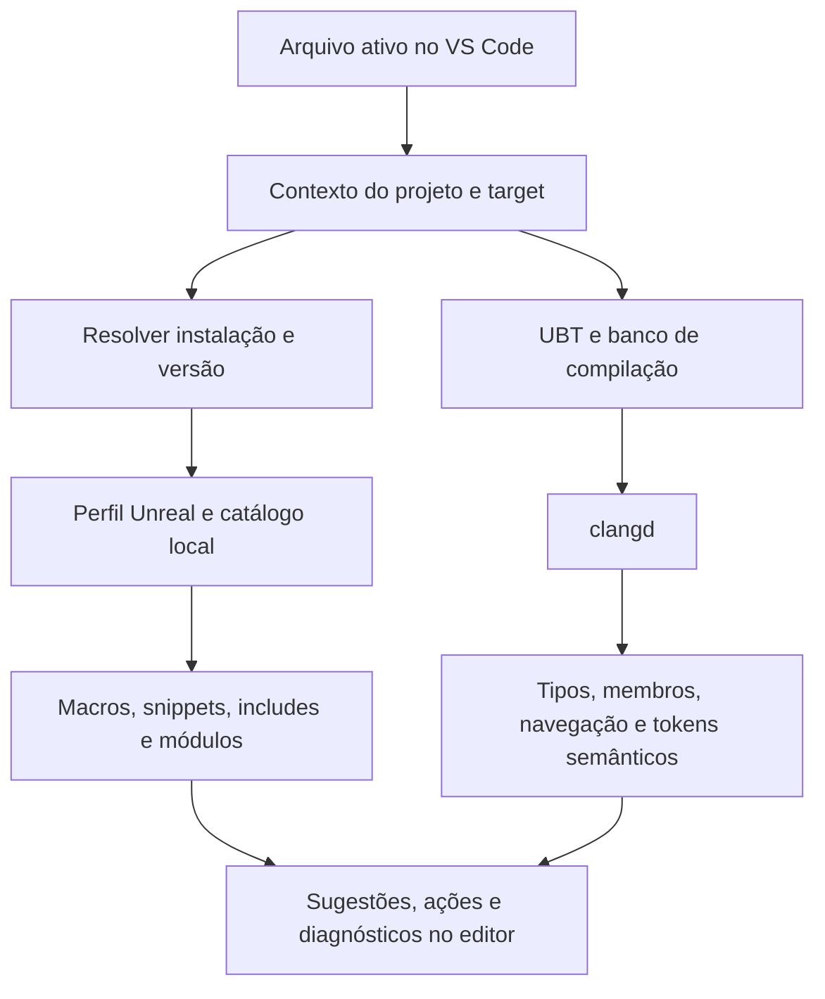

# Extensão Unreal para VS Code — especificação para UE 5.6

Documento de planejamento técnico, baseado na inspeção do ActionRoguelike e da instalação local da Unreal Engine em **21/10/2026**.

**Objetivo:** construir uma extensão em TypeScript que reconheça o projeto Unreal e a instalação correspondente, ofereça recursos específicos da engine e use clangd para a compreensão semântica de C++.

**Situação deste documento:** levantamento e proposta de implementação. Os recursos descritos ainda precisam ser construídos e testados. A instalação inspecionada é **UE 5.6.1**, associada a um projeto que declara **5.6**.

## 1. Produto e escopo inicial

A extensão deve ajudar quem abre um projeto Unreal no VS Code a responder:

- Qual projeto, módulo e target correspondem ao arquivo que estou editando?
- Qual versão o projeto declara e qual instalação da engine está sendo usada na configuração?
- O autocomplete tem os argumentos corretos de compilação?
- Qual header e qual módulo fornecem este símbolo?
- Quais especificadores são adequados nesta macro da Unreal?
- Como criar uma classe ou struct respeitando as convenções do módulo?

O primeiro ambiente de validação será **Windows + ActionRoguelikeEditor + Win64 + Development + UE 5.6.1**. O target Game também terá verificações próprias, porque uma configuração Editor pode esconder dependências que falhariam no jogo empacotado.

| Recurso | Primeira entrega | Evolução |
| --- | --- | --- |
| Reconhecer `.uproject`, módulos e engine | Sim | Vários projetos e instalações simultâneos |
| Mostrar versão exata e origem da detecção | Sim | Comparar perfis de outras versões |
| Diagnosticar banco de compilação e arquivos gerados | Sim | Regeneração e integração com build |
| Snippets de tipos e macros | Sim | Assistente para criar pares `.h`/`.cpp` |
| Destaque de macros Unreal | Sim | Ajustes de tema e testes de interação com tokens semânticos |
| Completar especificadores | Conjunto revisado da 5.6 | Mais contextos, metadados e regras |
| Inserir includes | Catálogo inicial + ação de código + sugestões próprias | Índice ampliado e integração ao cliente LSP |
| Tipos, membros, herança e templates C++ | clangd configurado | Melhor integração e desempenho |
| Sugerir dependências de módulos | Diagnóstico com evidência | Edição assistida de `.Build.cs` |
| Inspecionar assets e Blueprints | Fora da primeira entrega | Exige outra fonte de dados, possivelmente integração com o Editor |

A primeira versão será uma extensão do VS Code. **Não é necessário criar um plugin Unreal para entregar o núcleo inicial.** Uma integração dentro do Editor pode ser avaliada depois para obter informações de execução ou assets que não estão nos headers.

## 2. O que foi encontrado neste ambiente

### 2.1. Projeto e configuração

| Item | Evidência local | Consequência para a extensão |
| --- | --- | --- |
| Projeto | `ActionRoguelike.uproject` | Descriptor principal |
| Associação declarada | `EngineAssociation: "5.6"` | Identificador de instalação; não informa o patch |
| Módulo do jogo | `ActionRoguelike`, tipo `Runtime` | Contexto para includes, snippets e macro de exportação |
| Macro de exportação usada | `ACTIONROGUELIKE_API` | Nome confirmado nos headers do projeto |
| Targets | `ActionRoguelike` e `ActionRoguelikeEditor` | Contextos Game e Editor distintos |
| Regras dos targets | `BuildSettingsVersion.V5` e `EngineIncludeOrderVersion.Unreal5_6` | Compatibilidade de build declarada; não substitui a versão da instalação |
| Dependências públicas | `Core`, `CoreUObject`, `Engine`, `InputCore` | Estado observado em `ActionRoguelike.Build.cs` |
| Dependências privadas | `EnhancedInput`, `Niagara` | Necessárias para sugestões ligadas a input e efeitos |
| Plugin explícito no descriptor | `ModelingToolsEditorMode`, restrito a Editor | Considerar disponibilidade por target |
| Workspace | Pastas `ActionRoguelike` e `UE5` | A engine é outra raiz do mesmo workspace |
| Provedor C++ recomendado atualmente | `ms-vscode.cpptools` | clangd exigirá uma escolha clara do provedor semântico |

As dependências acima refletem os arquivos como estavam durante a inspeção, incluindo alterações locais existentes. Este levantamento não modifica essas configurações.

### 2.2. Instalação da engine

Raiz inspecionada:

```text
C:\Program Files\Epic Games\UE_5.6
```

Dados de `Engine/Build/Build.version`:

```json
{
  "MajorVersion": 5,
  "MinorVersion": 6,
  "PatchVersion": 1,
  "Changelist": 44394996,
  "CompatibleChangelist": 43139311,
  "IsLicenseeVersion": 0,
  "IsPromotedBuild": 1,
  "BranchName": "++UE5+Release-5.6"
}
```

`Engine/Source/Runtime/Launch/Resources/Version.h` também declara major `5`, minor `6` e patch `1`.

Resultado esperado no produto:

```text
Projeto: ActionRoguelike
Associação declarada: 5.6
Instalação resolvida: Unreal Engine 5.6.1
Changelist: 44394996
Target selecionado: ActionRoguelikeEditor | Win64 | Development
```

O target acima é a escolha proposta para o primeiro teste. A configuração C++ existente também aponta para esse contexto, mas isso não comprova qual processo do Unreal Editor está aberto.

### 2.3. Banco de compilação: problema concreto já identificado

Existem os arquivos locais:

- `.vscode/c_cpp_properties.json`;
- `.vscode/compileCommands_ActionRoguelike.json`;
- `.vscode/compileCommands_Default.json`;
- diretórios de response files associados a essas bases.

O arquivo `compileCommands_ActionRoguelike.json` tem **somente três entradas**: `ActionRoguelike.Build.cs`, `ActionRoguelike.cpp` e `ActionRoguelike.h`. Ele não contém `RogueCharacter.cpp` nem `Projectiles/RogueProjectileMagic.cpp`.

Isso demonstra cobertura insuficiente para os arquivos que queremos usar na validação. Uma entrada para `.Build.cs` não representa uma unidade de tradução C++ útil ao clangd. A simples presença de um JSON de compilação não deve produzir o status “configuração pronta”.

As entradas usam `cl.exe` do MSVC `14.38.33130` e arquivos `@...rsp`. O response file do módulo inclui diretórios da engine, diretórios UHT e headers forçados de definições/PCH. A configuração do cpptools informa C++20; a extensão deverá confirmar o padrão nos argumentos efetivos da base usada pelo clangd.

`clangd` e `clang++` não foram encontrados no `PATH` desta sessão. Isso não exclui instalações em outros diretórios. Portanto, a compatibilidade semântica ainda não foi testada.

### 2.4. Código gerado disponível

Foram encontrados:

```text
Intermediate/Build/Win64/ActionRoguelikeEditor/Development/ActionRoguelikeEditor.uhtmanifest
Intermediate/Build/Win64/UnrealEditor/Inc/ActionRoguelike/UHT/RogueProjectileMagic.generated.h
Intermediate/Build/Win64/x64/UnrealEditor/Development/ActionRoguelike/Definitions.ActionRoguelike.h
```

O manifest identifica `ActionRoguelike` como `GameRuntime`, registra os headers do personagem e do projectile e informa o diretório de saída do UHT. Esses dados podem enriquecer o diagnóstico, mas são artefatos locais regeneráveis.

O `.gitignore` e o `.ignore` excluem diretórios gerados e `.vscode`. A futura extensão precisa consultar explicitamente os artefatos necessários mesmo quando não aparecem numa busca comum. O documento versionado deve continuar válido em um clone sem esses arquivos.

## 3. Detectar projeto, engine e atualização exata

### 3.1. Separar quatro informações

| Informação | Fonte | O que permite afirmar |
| --- | --- | --- |
| Associação declarada | `.uproject` | Instalação pretendida pelo projeto |
| Instalação resolvida | Configuração explícita, associação e descoberta local | Raiz selecionada para análise |
| Versão dessa instalação | `Build.version`, com verificação em `Version.h` | Major, minor, patch e identidade de build |
| Engine de um Editor em execução | Integração futura com processo/Editor | Qual instância está realmente executando o projeto |

O MVP cobre as três primeiras informações. A interface deve dizer “instalação resolvida” ou “engine configurada”. Para afirmar “Editor em execução na 5.6.1”, será necessário identificar a instância e vinculá-la ao projeto. Um log antigo ou o nome da pasta não comprova isso.

### 3.2. Descoberta do projeto

1. Procurar `.uproject` nas raízes do workspace, com limites e exclusões para conteúdo e artefatos.
2. Para um arquivo ativo, localizar o descriptor e o módulo que o contêm ou o referenciam.
3. Reconhecer `.uplugin` e seus módulos, tanto no projeto quanto na engine.
4. Se houver mais de um projeto candidato, manter contextos separados e permitir escolher o ativo.
5. Se apenas a pasta da engine estiver aberta, oferecer modo de exploração da engine e informar a ausência de contexto de projeto.
6. Aceitar projeto Blueprint sem `Source/`; nesse caso, os recursos de C++ dependem da criação de um módulo.

Não vincular todos os arquivos à primeira ocorrência de `.uproject`. Neste workspace, percorrer a raiz `UE5` indiscriminadamente também encontraria templates e samples.

### 3.3. Resolver a associação

Ordem proposta, preservando a origem e possíveis conflitos:

1. **Raiz explícita por projeto:** configuração do usuário para instalações customizadas.
2. **Associação com caminho:** resolver o caminho relativo ao diretório do `.uproject`, como faz o DesktopPlatform local.
3. **Associação com identificador:** consultar instalações conhecidas do Launcher ou builds registrados pelo usuário.
4. **Associação vazia:** verificar o caso de projeto dentro de uma árvore de engine, conforme o comportamento do DesktopPlatform.
5. **Evidências auxiliares:** raiz da engine aberta no workspace, argumentos de compilação e tarefas geradas.
6. **Persistência de ambiguidade:** apresentar os candidatos e solicitar escolha no fluxo da extensão.

No Windows, o código inspecionado em `DesktopPlatformWindows.cpp` usa `HKCU\SOFTWARE\Epic Games\Unreal Engine\Builds` para builds registrados pelo usuário. O DesktopPlatform também lê `UnrealEngineLauncher/LauncherInstalled.dat` no diretório de configurações da aplicação, usando `InstallationList`, `AppName` e `InstallLocation`.

A implementação deve resolver o diretório de configurações do sistema e consultar esses dados apenas para leitura. Não precisa reproduzir os efeitos de manutenção do registro que existem no DesktopPlatform.

Validar cada candidato pela estrutura da engine e seus metadados. Não escolher uma instalação só porque a pasta se chama `UE_5.6`. Uma configuração explícita que diverge da associação deve permanecer visível como escolha do usuário com aviso de divergência.

### 3.4. Ler e comparar versões

- Usar `Engine/Build/Build.version` como fonte principal da identidade da instalação.
- Consultar `Engine/Source/Runtime/Launch/Resources/Version.h` como verificação e fallback parcial.
- Se só `Version.h` estiver disponível, registrar que changelist e branch podem estar desconhecidos.
- Se as fontes divergirem, mostrar a divergência e reduzir a confiança da detecção.
- Comparar componentes numéricos: `5.10` é posterior a `5.6`; não comparar strings lexicalmente.
- Tratar `EngineAssociation` como identificador opaco quando não for um caminho ou versão reconhecida; pode ser um GUID de build customizado.
- Usar major/minor para selecionar um perfil inicial de regras e patch/changelist para invalidar caches e aplicar diferenças revisadas.
- Em builds customizados, um mesmo `5.6.1` pode conter APIs alteradas. Os headers e os argumentos locais precisam prevalecer sobre um catálogo genérico.

### 3.5. Modelo proposto de contexto

Exemplo de contrato interno; ainda não é código implementado:

```ts
interface UnrealProjectContext {
  projectFile: string;
  declaredAssociation: string;
  engineRoot?: string;
  engineVersion?: {
    major: number;
    minor: number;
    patch: number;
    changelist?: number;
    compatibleChangelist?: number;
    branch?: string;
  };
  resolutionSource: "setting" | "association" | "parent" | "workspace" | "unresolved";
  confidence: "confirmed" | "partial" | "ambiguous";
  target?: { name: string; platform: string; configuration: string };
  compilationDatabase?: string;
  generatedCodeState: "unknown" | "missing" | "present" | "possibly-stale";
  runtimeEditorState: "unknown"; // MVP: sem integração de execução.
}
```

Também guardar os candidatos e os motivos da resolução para o relatório de diagnóstico. Evitar um único contexto global: um arquivo da engine pode ser analisado para mais de um projeto/target.

## 4. Arquitetura proposta



| Componente | Responsabilidade |
| --- | --- |
| `ProjectDiscovery` | Descriptors, raízes, plugins e arquivos pertencentes a cada contexto |
| `EngineResolver` | Associação, instalação, versão e evidências |
| `BuildContextService` | Target/plataforma/configuração, base de compilação, response files e UHT |
| `UnrealCatalog` | Símbolos iniciais, headers, módulos, especificadores e proveniência |
| `MacroContextParser` | Contexto lexical tolerante a código incompleto |
| `IncludePlanner` | Calcular uma edição válida, sem duplicações e com posição correta |
| `ModuleAdvisor` | Indicar dependências conhecidas e incertezas de `.Build.cs` |
| `UnrealCompletionProvider` | Especificadores e sugestões do catálogo próprio |
| `UnrealCodeActions` | Ações de include e explicações de diagnóstico |
| `DiagnosticsView` | Versão, cobertura, estado do clangd e próximos passos |
| `CacheService` | Índices incrementais e invalidação por instalação/target |

O clangd faz análise semântica de C++, usando AST e índice. A camada Unreal acrescenta conhecimento de reflexão, build e organização da engine. Essa divisão se apoia na [arquitetura documentada do clangd](https://clangd.llvm.org/design/code).

### 4.1. Decisão sobre o cliente clangd

**Primeira entrega:** conviver com a extensão clangd já existente, oferecendo recursos Unreal por providers próprios e ações de código. O produto precisa deixar claro quem fornece a análise C++ e quem insere includes.

A API estável de um `CompletionItemProvider` não oferece um middleware geral para reescrever os itens pertencentes a outra extensão. Portanto, “selecionar qualquer sugestão do clangd e interceptar sua edição de include” não pode ser assumido como resolvido por adicionar um provider.

Para sugestões que nós mesmos produzirmos, usar `CompletionItem.additionalTextEdits`. Para símbolos já digitados, oferecer ação de código. Essas são capacidades da [API de CompletionItem](https://code.visualstudio.com/api/references/vscode-api#CompletionItem).

**Evolução:** se quisermos controlar todas as edições vindas do clangd, estudar um cliente LSP próprio com middleware de completion, resolução e ações. Esse modo substituirá o cliente clangd externo para os documentos atendidos, evitando dois servidores concorrentes.

Não iniciar um segundo clangd silenciosamente. A configuração atual recomenda cpptools; a escolha do provedor semântico deve ser explícita e reversível. Recursos de build/debug podem permanecer independentes dessa escolha.

## 5. Preparar o clangd para a Unreal 5.6

### 5.1. Contexto necessário

Para cada unidade de tradução, precisamos do diretório de trabalho, compilador/driver, includes, defines, padrão C++, target e headers forçados. Headers sem comando próprio podem ser analisados a partir de uma unidade de tradução relacionada, mas a associação precisa ser verificável. Ver [comandos de compilação do clangd](https://clangd.llvm.org/design/compile-commands).

Não fabricar uma configuração com milhares de `-I` recursivos e macros vazias. Isso pode ocultar o problema enquanto quebra seleção de plataforma, exports, código gerado e tipos dependentes de defines.

### 5.2. Pipeline proposto

1. Resolver engine e target.
2. Descobrir `clangd`, verificar `--version` e registrar o executável escolhido.
3. Identificar compilador, SDK e ferramentas exigidas pelo UBT para aquele target.
4. Inspecionar bases já geradas; validar cobertura dos `.cpp`, referências `@rsp` e existência dos headers forçados.
5. Preferir uma base produzida pelo modo `GenerateClangDatabase` do UBT quando a base existente não for adequada.
6. Salvar a base derivada por projeto/target e apontar o clangd para o diretório que contém `compile_commands.json`.
7. Validar a análise de um `.cpp` real antes de declarar a configuração pronta.

O nome `compileCommands_ActionRoguelike.json` é referenciado pelo cpptools, mas não é o nome padrão procurado pelo clangd. Uma integração precisa produzir a base no local/formato esperado ou configurá-la explicitamente; renomear um arquivo incompleto não corrige sua cobertura. Ver [configuração de projeto do clangd](https://clangd.llvm.org/installation#project-setup).

### 5.3. O que o UBT 5.6.1 já oferece

Inspeção de `Engine/Source/Programs/UnrealBuildTool/Modes/GenerateClangDatabase.cs`:

| Comportamento/opção | Encontrado no código local |
| --- | --- |
| Modo | `GenerateClangDatabase` |
| Nome padrão | `compile_commands.json` |
| Diretório padrão | Raiz da Unreal; devemos fornecer um diretório local apropriado |
| Saída configurável | `-OutputDir=` e `-OutputFilename=` |
| Filtros | `-Include=` e `-Exclude=` |
| Includes gerados | Força inclusão dos diretórios de código gerado |
| Unity build | Desativado nesse modo |
| PCH/VFS | Adiciona `-NoPCH` e `-NoVFS` |
| Compilador | Adiciona `-Compiler=Clang` se não houver seleção explícita |
| Ações de geração | Ativadas por padrão; opções `-ExecCodeGenActions` / `-NoExecCodeGenActions` |

Esses comportamentos são específicos do código inspecionado. A execução pode exigir uma toolchain Clang compatível e pode acionar geração de código e passos de prebuild; não é uma simples conversão de JSON.

Exemplo de comando **a validar na implementação**, executado na raiz do projeto:

```powershell
$ueRoot = 'C:\Program Files\Epic Games\UE_5.6'
$projectFile = Join-Path (Get-Location).Path 'ActionRoguelike.uproject'
$databaseDir = Join-Path (Get-Location).Path 'Intermediate\UnrealAssist\ActionRoguelikeEditor-Win64-Development'
New-Item -ItemType Directory -Force -Path $databaseDir | Out-Null
& "$ueRoot\Engine\Build\BatchFiles\Build.bat" `
    -Mode=GenerateClangDatabase `
    ActionRoguelikeEditor Win64 Development `
    "-Project=$projectFile" `
    "-OutputDir=$databaseDir"
```

`Build.bat` existe nesta instalação e encaminha os argumentos ao UBT usando a configuração de .NET da engine. Não foi encontrado um `RunUBT.bat` nessa pasta; existe `RunUBT.sh`. O comando acima foi documentado por leitura de código e **não foi executado neste levantamento**.

### 5.4. Diagnósticos mínimos

| Código proposto | Condição | Resposta útil |
| --- | --- | --- |
| `UE-CONFIG-001` | Engine não resolvida | Mostrar associação e candidatos |
| `UE-CONFIG-002` | Fontes de versão divergentes | Mostrar valores e caminhos |
| `UE-CDB-001` | Base ausente ou inválida | Oferecer preparação pelo UBT |
| `UE-CDB-002` | `.cpp` do contexto sem entrada | Mostrar cobertura e sugerir regeneração |
| `UE-CDB-003` | Response file/header forçado inexistente | Mostrar referência quebrada |
| `UE-UHT-001` | Header gerado necessário ausente | Orientar geração/build via UBT |
| `UE-UHT-002` | Evidências de código gerado desatualizado | Explicar evidências; confirmar com UBT |
| `UE-LSP-001` | clangd ausente ou falhando | Mostrar executável, versão e erro |
| `UE-LSP-002` | Provedores semânticos concorrentes | Oferecer escolha de integração |

No ActionRoguelike, `UE-CDB-002` é um caso reproduzível pelo inventário local. Não afirmar que todo erro atual de IntelliSense decorre apenas dessa base; ainda faltam testes com o servidor.

## 6. Classes, structs, aliases e templates para o catálogo inicial

Os caminhos abaixo são relativos a `Engine/`. O include exibido ao usuário é relativo à raiz pública do módulo, não à instalação inteira. Os headers foram usados como referências locais; a seleção exata do include deve continuar respeitando o contexto de compilação.

### 6.1. Gameplay e componentes

| Símbolo | Natureza | Include sugerido | Módulo | Header de referência |
| --- | --- | --- | --- | --- |
| `AActor` | Classe base de atores | `GameFramework/Actor.h` | `Engine` | `Source/Runtime/Engine/Classes/GameFramework/Actor.h` |
| `ACharacter` | Classe de personagem | `GameFramework/Character.h` | `Engine` | `Source/Runtime/Engine/Classes/GameFramework/Character.h` |
| `UActorComponent` | Componente | `Components/ActorComponent.h` | `Engine` | `Source/Runtime/Engine/Classes/Components/ActorComponent.h` |
| `USceneComponent` | Componente com transformação | `Components/SceneComponent.h` | `Engine` | `Source/Runtime/Engine/Classes/Components/SceneComponent.h` |
| `UPrimitiveComponent` | Base de componentes primitivos | `Components/PrimitiveComponent.h` | `Engine` | `Source/Runtime/Engine/Classes/Components/PrimitiveComponent.h` |
| `USphereComponent` | Colisão esférica | `Components/SphereComponent.h` | `Engine` | `Source/Runtime/Engine/Classes/Components/SphereComponent.h` |
| `UProjectileMovementComponent` | Movimento de projétil | `GameFramework/ProjectileMovementComponent.h` | `Engine` | `Source/Runtime/Engine/Classes/GameFramework/ProjectileMovementComponent.h` |
| `UGameplayStatics` | Biblioteca de funções | `Kismet/GameplayStatics.h` | `Engine` | `Source/Runtime/Engine/Classes/Kismet/GameplayStatics.h` |
| `UDamageType` | Tipo de dano | `GameFramework/DamageType.h` | `Engine` | `Source/Runtime/Engine/Classes/GameFramework/DamageType.h` |
| `UCameraComponent` | Câmera | `Camera/CameraComponent.h` | `Engine` | `Source/Runtime/Engine/Classes/Camera/CameraComponent.h` |
| `USpringArmComponent` | Braço de câmera | `GameFramework/SpringArmComponent.h` | `Engine` | `Source/Runtime/Engine/Classes/GameFramework/SpringArmComponent.h` |
| `FHitResult` | Struct refletida | `Engine/HitResult.h` | `Engine` | `Source/Runtime/Engine/Classes/Engine/HitResult.h` |

### 6.2. Input e Niagara

| Símbolo | Include sugerido | Módulo | Header de referência |
| --- | --- | --- | --- |
| `UEnhancedInputComponent` | `EnhancedInputComponent.h` | `EnhancedInput` | `Plugins/EnhancedInput/Source/EnhancedInput/Public/EnhancedInputComponent.h` |
| `UInputAction` | `InputAction.h` | `EnhancedInput` | `Plugins/EnhancedInput/Source/EnhancedInput/Public/InputAction.h` |
| `FInputActionInstance` | `InputAction.h` | `EnhancedInput` | `Plugins/EnhancedInput/Source/EnhancedInput/Public/InputAction.h` |
| `FInputActionValue` | `InputActionValue.h` | `EnhancedInput` | `Plugins/EnhancedInput/Source/EnhancedInput/Public/InputActionValue.h` |
| `UNiagaraSystem` | `NiagaraSystem.h` | `Niagara` | `Plugins/FX/Niagara/Source/Niagara/Classes/NiagaraSystem.h` |
| `UNiagaraComponent` | `NiagaraComponent.h` | `Niagara` | `Plugins/FX/Niagara/Source/Niagara/Public/NiagaraComponent.h` |
| `UNiagaraFunctionLibrary` | `NiagaraFunctionLibrary.h` | `Niagara` | `Plugins/FX/Niagara/Source/Niagara/Public/NiagaraFunctionLibrary.h` |

Os módulos de um plugin não têm necessariamente o mesmo nome do plugin. O descriptor local do Niagara contém vários módulos. Também declara `EnabledByDefault: true`; a ausência de uma entrada explícita no `.uproject` não basta para concluir que Niagara está desativado. Avaliar disponibilidade efetiva por descriptor, target e dados do build.

### 6.3. Tipos fundamentais

| Símbolo | Natureza real relevante | Include inicial | Módulo |
| --- | --- | --- | --- |
| `UObject` | Base de objetos | `UObject/Object.h` | `CoreUObject` |
| `TObjectPtr<T>` | Template implementado como struct | `UObject/ObjectPtr.h` | `CoreUObject` |
| `TSubclassOf<T>` | Template de referência a classe compatível | `Templates/SubclassOf.h` | `CoreUObject` |
| `TSoftObjectPtr<T>` | Referência soft a objeto | `UObject/SoftObjectPtr.h` | `CoreUObject` |
| `FVector` | Alias para `UE::Math::TVector<double>` nesta instalação | `Math/Vector.h` | `Core` |
| `FVector3f` | Alias de vetor com componentes float | `Math/Vector.h` | `Core` |
| `FRotator` | Alias de tipo matemático | `Math/Rotator.h` | `Core` |
| `FName` | Classe C++ | `UObject/NameTypes.h` | `Core` |
| `FString` | Tipo string da engine | `Containers/UnrealString.h` | `Core` |
| `TArray<T>` | Container template | `Containers/Array.h` | `Core` |
| `TMap<K, V>` | Container template | `Containers/Map.h` | `Core` |

`FVector` é declarado como alias em `Source/Runtime/Core/Public/Math/MathFwd.h`; o header de definição sugerido é `Math/Vector.h`. O prefixo `F` não determina se algo é struct, classe ou alias. Da mesma forma, `TObjectPtr` não deve receber classificação “classe” só pelo seu nome. A classificação semântica deve vir do C++.

Prefixos Unreal ajudam em nomes de snippets, mas não substituem análise. `TObjectPtr` não torna qualquer ponteiro isolado uma raiz de GC; os snippets devem seguir os padrões de propriedades refletidas adequados ao tipo e ao proprietário.

### 6.4. Modelo de entrada do catálogo

Cada registro precisa guardar:

```json
{
  "name": "UGameplayStatics",
  "kind": "class",
  "include": "Kismet/GameplayStatics.h",
  "module": "Engine",
  "visibility": "public",
  "engineProfile": "5.6",
  "verifiedBuild": "5.6.1-44394996",
  "sourcePath": "Engine/Source/Runtime/Engine/Classes/Kismet/GameplayStatics.h",
  "evidence": "reviewed-local-header"
}
```

Acrescentar namespace, plugin, condições de plataforma/target, depreciação e candidatos alternativos conforme o índice crescer. Não inventar um intervalo de versões suportadas a partir de uma única instalação.

## 7. Reflexão, macros e especificadores

### 7.1. Por que clangd não resolve toda a experiência Unreal

Em `UObject/ObjectMacros.h`, macros como `UPROPERTY` e `UFUNCTION` não entregam ao parser C++ comum a validação completa de seus argumentos. O UHT tem sua própria análise e gera o código que sustenta a reflexão. `GENERATED_BODY` participa de expansões ligadas ao arquivo e à linha.

O fluxo de compilação é UBT → UHT/código gerado → compilador C++. Nossa extensão deve reconhecer falhas nessa cadeia. Uma macro vazia usada para esconder erro não substitui o código gerado. Ver [Unreal Header Tool na UE 5.6](https://dev.epicgames.com/documentation/en-us/unreal-engine/unreal-header-tool-for-unreal-engine?application_version=5.6).

### 7.2. Fontes locais de regras

Base: `Engine/Source/Programs/Shared/EpicGames.UHT/`.

| Arquivo | Conteúdo a aproveitar |
| --- | --- |
| `Specifiers/UhtClassSpecifiers.cs` | Especificadores de classes |
| `Specifiers/UhtScriptStructSpecifiers.cs` | Especificadores de structs |
| `Specifiers/UhtEnumSpecifiers.cs` | Especificadores de enums |
| `Specifiers/UhtInterfaceClassSpecifiers.cs` | Especificadores de interfaces |
| `Specifiers/UhtFunctionSpecifiers.cs` | Funções, eventos e RPCs |
| `Specifiers/UhtPropertyMemberSpecifiers.cs` | Propriedades de membros e incompatibilidades |
| `Specifiers/UhtPropertyArgumentSpecifiers.cs` | Especificadores de parâmetros |
| `Specifiers/UhtDefaultSpecifiers.cs` | Regras comuns e metadados |
| `Parsers/UhtSpecifierParser.cs` | Sintaxe e interpretação dos especificadores |
| `Tables/UhtSpecifierTable.cs` | Registro de especificadores |
| `Parsers/UhtHeaderFileParser.cs` | Includes e regras do header refletido |

Também consultar `UObject/ObjectMacros.h` como referência de macros e nomes. Um catálogo pode ser extraído parcialmente desses arquivos, mas a extração precisa de revisão: atributos, tabelas herdadas, nomes implícitos e validadores não formam um contrato JSON pronto.

### 7.3. Conjunto inicial de sugestões

Lista de partida para revisão e testes; não representa todos os especificadores da engine:

| Contexto | Exemplos de candidatos |
| --- | --- |
| `UCLASS(...)` | `Abstract`, `Blueprintable`, `BlueprintType`, `NotBlueprintable`, `Transient`, `Config=`, `ClassGroup=` |
| `USTRUCT(...)` | `BlueprintType`, `Atomic`, `NoExport` |
| `UENUM(...)` | `BlueprintType`, `Flags` |
| `UINTERFACE(...)` | `MinimalAPI`, `BlueprintType` |
| `UPROPERTY(...)` | `EditAnywhere`, `EditDefaultsOnly`, `VisibleAnywhere`, `BlueprintReadOnly`, `BlueprintReadWrite`, `Transient`, `Replicated`, `ReplicatedUsing=`, `SaveGame`, `Category=` |
| `UFUNCTION(...)` | `BlueprintCallable`, `BlueprintPure`, `BlueprintImplementableEvent`, `BlueprintNativeEvent`, `Server`, `Client`, `NetMulticast`, `Reliable`, `Unreliable`, `Category=` |
| `meta=(...)` | Candidatos filtrados pelo proprietário: `DisplayName`, `ToolTip`, `AllowPrivateAccess`, `ClampMin`, `ClampMax`, `BlueprintSpawnableComponent` |
| `UMETA(...)` | Metadados de valor de enum, por exemplo `DisplayName`, `Hidden` |

Separar especificadores de nível superior de metadados aninhados. Um metadado apropriado para classe de componente não deve aparecer indiscriminadamente em propriedades. A documentação de [metadados da UE 5.6](https://dev.epicgames.com/documentation/en-us/unreal-engine/metadata-specifiers-in-unreal-engine?application_version=5.6) descreve essa organização por contexto.

Regras já confirmadas no UHT local para propriedades:

- Permitir apenas uma escolha do grupo `Edit*`/`Visible*`.
- Não combinar `BlueprintReadOnly` com `BlueprintReadWrite`.
- Considerar acesso privado e `meta=(AllowPrivateAccess=...)` para exposição a Blueprint.

Conflitos mais complexos, RPCs e validações dependentes do tipo devem ser incorporados com exemplos que o UHT aceite/rejeite. Não prometer reproduzir integralmente o compilador de reflexão.

### 7.4. Parser de contexto

O parser precisa trabalhar enquanto o código está incompleto:

```cpp
UPROPERTY(EditDefaultsOnly, Category="Effects", meta=(DisplayName="Impacto", Cla
```

Identificar macro proprietária, profundidade de parênteses, posição da lista, chave/valor e itens já presentes. Suportar múltiplas linhas, strings, escapes, comentários e vírgulas dentro de valores. Ignorar ocorrências de `UPROPERTY` em comentário, string comum ou raw string.

Usar tokenização lexical e análise delimitada; uma regex isolada não resolve esses estados. Se o contexto for incerto ou houver `#if` complexo, limitar a sugestão e evitar um diagnóstico categórico.

Cada sugestão deve explicar o efeito em português, mostrar sintaxe de valor quando necessária e registrar a fonte da regra. Tipos C++ completos e resolução de herança permanecem responsabilidade do clangd.

## 8. Auto include: comportamento especificado

### 8.1. Caso principal: `UGameplayStatics`

No projectile atual, `Kismet/GameplayStatics.h` já está incluído. Para validar a inserção, criar uma fixture ou cópia temporária sem esse include.

Fluxo esperado:

1. Usuário digita `UGameplaySta` e aceita uma sugestão própria, ou solicita correção após digitar `UGameplayStatics`.
2. Resolver símbolo para `Kismet/GameplayStatics.h`, módulo `Engine`.
3. Verificar disponibilidade do header no contexto e includes existentes.
4. Calcular inserção sem alterar a ordem estrutural do arquivo.
5. Inserir o símbolo e o include na mesma aceitação quando a sugestão for nossa; na ação de código, aplicar uma edição revisável.
6. Informar dependência de módulo apenas se houver evidência de problema. Neste projeto, `Engine` já é dependência pública.

Em `RogueProjectileMagic.cpp`, preservar `#include "RogueProjectileMagic.h"` como primeiro include. Em `RogueProjectileMagic.h`, inserir qualquer include necessário **antes** de `RogueProjectileMagic.generated.h`.

### 8.2. Regras obrigatórias do planejador

- Nunca inserir um include normal depois de `.generated.h` em um header refletido. A regra está implementada em `UhtHeaderFileParser.cs`.
- Preservar o include do próprio header como primeiro include do `.cpp` quando ele já estiver nessa posição.
- Não duplicar includes; comparar também formas equivalentes resolvidas pelo contexto.
- Preservar encoding, BOM, CRLF/LF, comentários, licença e espaçamento existente.
- Calcular posições a partir da versão atual do documento; descartar ou recalcular uma edição que ficou obsoleta.
- As edições adicionais da sugestão não podem se sobrepor à substituição principal nem entre si.
- Nunca escolher um arquivo `.generated.h`, `.gen.cpp` ou header privado da engine como include público para o usuário.
- Não reorganizar todos os includes para entregar uma inserção pontual.
- Se houver erro estrutural prévio, condicionais ambíguas ou mais de um candidato equivalente, oferecer uma ação com contexto em vez de inserir às cegas.
- Tratar uma inclusão dentro de `#if` como condicional; ela não satisfaz automaticamente um uso fora desse bloco.

### 8.3. Header, declaração antecipada ou nenhuma mudança

O projectile já usa declarações antecipadas para Niagara e componentes no header e inclui definições no `.cpp`. Esse padrão deve ser entendido pela ferramenta.

| Uso | Decisão inicial |
| --- | --- |
| Classe base, como `public AActor` | Exige definição da base |
| Chamada `UGameplayStatics::ApplyDamage(...)` | Include da declaração da biblioteca |
| `CreateDefaultSubobject<USphereComponent>(...)` | Definição do componente no contexto de instanciação |
| Acesso a membro por ponteiro | clangd confirma o tipo; incluir definição quando necessária |
| Ponteiro/referência em declaração | Considerar declaração antecipada, respeitando UHT e templates |
| Membro armazenado por valor | Geralmente exige definição completa; confirmar natureza do tipo |
| Alias como `FVector` | Não inventar `struct FVector;`; resolver alias e header correto |
| Header já incluído diretamente | Nenhuma edição |

Não remover includes existentes nem converter declarações automaticamente durante uma sugestão. Uma futura refatoração pode cuidar dessas mudanças com validação própria.

### 8.4. Convivência com o auto include do clangd

Definir um único responsável por cada fluxo. Para validar as regras Unreal com nosso provider no primeiro protótipo, pode-se desativar a inserção automática do clangd no contexto selecionado, mantendo suas sugestões semânticas. A opção documentada é `Completion.HeaderInsertion: Never`, respeitada a versão do clangd escolhido. Ver [configuração do clangd](https://clangd.llvm.org/config#headerinsertion).

Essa configuração não transforma sugestões externas em sugestões nossas. A experiência inicial continua sendo: catálogo próprio com inserção associada e ação de código para outros casos conhecidos. Uma solução que controle todas as sugestões exige a integração LSP discutida na seção 4.1.

## 9. Dependências de módulos e plugins

Um include correto não resolve sozinho uma dependência ausente de módulo. A estrutura e as dependências são definidas no sistema de módulos da Unreal, descrito na [documentação de módulos da UE 5.6](https://dev.epicgames.com/documentation/en-us/unreal-engine/unreal-engine-modules?application_version=5.6).

Cada candidato de include deve carregar módulo, plugin, visibilidade e restrições de target. Derivar o caminho público a partir de `Public/`, do legado `Classes/` e das raízes efetivamente exportadas no build; não obter o módulo apenas removendo diretórios do caminho.

### 9.1. Regras para aconselhamento

- Implementação em `.cpp` ou header privado: dependência privada costuma ser suficiente.
- Tipo necessário na interface pública: avaliar dependência pública, especialmente quando consumidores precisam do header da dependência.
- Uma declaração antecipada pode evitar exposição de um header, mas não elimina todas as necessidades de dependência. Avaliar o uso completo.
- Header privado de outro módulo não deve virar sugestão pública.
- Símbolo de módulo Editor não deve ser oferecido como solução para código Runtime incompatível.
- Plugin desativado exige diagnóstico de disponibilidade, além da dependência do módulo.

O projeto não usa a separação `Public/Private` nos headers atuais. O manifest UHT os lista em `PrivateHeaders`; isso auxilia a análise, mas o aconselhamento deve considerar também como o módulo exporta e consome sua interface. Não classificar apenas pela extensão `.h`.

### 9.2. Limites de leitura de `.Build.cs`

`.Build.cs` é C# executável: pode ter condicionais por plataforma, helpers, variáveis e regras herdadas. Uma busca textual identifica bem os `AddRange` literais presentes neste projeto, mas não prova todas as dependências efetivas.

Priorizar dados do UBT, quando disponíveis. Em leitura estática parcial, declarar a incerteza. Nunca concluir “dependência ausente” só porque um nome não apareceu num regex.

No primeiro MVP, explicar e sugerir o trecho apropriado. Uma evolução pode oferecer `WorkspaceEdit` com prévia para inserir a dependência em um bloco simples identificado com segurança. Regras complexas devem receber orientação localizada.

Exemplo de mensagem hipotética ao usar Niagara em outro módulo sem a dependência:

```text
UNiagaraFunctionLibrary
Header: NiagaraFunctionLibrary.h
Módulo: Niagara
Uso detectado na implementação: considerar PrivateDependencyModuleNames.
```

No ActionRoguelike atual, `Niagara` já está em `PrivateDependencyModuleNames`; não devemos sugerir adicioná-lo novamente.

## 10. Snippets e criação de tipos

### 10.1. Catálogo inicial

| Atalho proposto | Resultado |
| --- | --- |
| `ue.actor` | Classe derivada de `AActor` |
| `ue.character` | Classe derivada de `ACharacter` |
| `ue.component` | Classe derivada de `UActorComponent` |
| `ue.scenecomponent` | Classe derivada de `USceneComponent` |
| `ue.object` | Classe derivada de `UObject` |
| `ue.struct` | `USTRUCT` com `GENERATED_BODY` |
| `ue.enum` | `UENUM` e `enum class` |
| `ue.interface` | Par `UINTERFACE` / interface C++ |
| `ue.property` | `UPROPERTY` com campos editáveis |
| `ue.function` | `UFUNCTION` com campos editáveis |
| `ue.delegate` | Família de delegate escolhida explicitamente |

Campos: nome, classe base, módulo, categoria, especificadores e tipos. O modo avançado de criação precisa determinar pasta, `.generated.h` correspondente e macro de exportação do módulo. Não fixar `ACTIONROGUELIKE_API` para todos os projetos.

Trecho ilustrativo para um novo componente; `YourModule` e os nomes são campos a substituir:

```cpp
#pragma once

#include "CoreMinimal.h"
#include "Components/ActorComponent.h"
#include "ImpactEffectComponent.generated.h"

UCLASS(ClassGroup=(Custom), meta=(BlueprintSpawnableComponent))
class YOURMODULE_API UImpactEffectComponent : public UActorComponent
{
    GENERATED_BODY()

public:
    UImpactEffectComponent();
};
```

O snippet do header precisa acompanhar a declaração/definição do construtor no `.cpp` quando houver criação de arquivos. Snippets inseridos no editor e geração de arquivos são fluxos distintos; criação deve detectar colisões antes de escrever.

Uma struct refletida deve conter `USTRUCT`, `GENERATED_BODY` e propriedades adequadas quando necessárias. Uma struct C++ comum não precisa desses elementos. O assistente deve permitir escolher a intenção.

## 11. Cores e destaque

**Camada sintática:** gramática de injeção TextMate para macros e seus contextos, mantendo a linguagem C++ existente. Reconhecer `UCLASS`, `UPROPERTY`, `UFUNCTION`, `USTRUCT`, `UENUM`, `UINTERFACE`, `UPARAM`, `UMETA` e `GENERATED_BODY`. As regras precisam respeitar comentários e strings. Ver [guia de destaque sintático do VS Code](https://code.visualstudio.com/api/language-extensions/syntax-highlight-guide).

**Camada semântica:** clangd fornece a classificação de tipos, funções, parâmetros, propriedades e variáveis. Temas controlam a aparência dos tokens. Não fixar cores RGB para “todo nome que começa com U”. Ver [guia de destaque semântico](https://code.visualstudio.com/api/language-extensions/semantic-highlight-guide).

Evitar registrar um segundo provider semântico completo para o mesmo documento na primeira versão. Testar a interação da gramática Unreal com os tokens do clangd e documentar os scopes oferecidos ao tema.

Aceitação visual: macros reconhecíveis, especificadores dentro do contexto correto e classes/funções/variáveis distinguidas quando o servidor estiver pronto. O produto deve continuar legível com destaque semântico desativado ou durante indexação.

## 12. Experiência no VS Code

### 12.1. Barra de status e relatório

Proposta de status compacto:

```text
UE 5.6.1 · ActionRoguelikeEditor · Win64
```

Ao abrir o diagnóstico, mostrar projeto, associação, raiz resolvida, patch/changelist, origem/confiança, configuração selecionada, módulos, cobertura da base, estado dos gerados e provedor C++.

No ambiente atual, um relatório honesto seria:

```text
Associação do projeto: 5.6
Instalação inspecionada: 5.6.1 / CL 44394996
Base existente: 3 entradas; personagem e projectile sem entrada própria
Código gerado do projectile: encontrado
clangd: não encontrado no PATH desta sessão; localização adicional pendente
Editor em execução: não verificado
```

### 12.2. Comandos propostos

- `Unreal: Diagnosticar projeto`;
- `Unreal: Selecionar engine`;
- `Unreal: Selecionar target de análise`;
- `Unreal: Preparar banco de compilação`;
- `Unreal: Mostrar header e módulo do símbolo`;
- `Unreal: Adicionar include`;
- `Unreal: Criar tipo C++`;
- `Unreal: Reindexar contexto atual`;
- `Unreal: Abrir documentação da versão detectada`.

As mensagens ao usuário devem explicar a consequência prática: “o projectile não está coberto pelo banco de compilação” é mais útil do que apenas “CDB inválida”. Agrupar problemas de configuração para evitar dezenas de erros derivados da mesma causa.

## 13. Indexação, cache e desempenho

### 13.1. Começar com um catálogo pequeno e verificável

Usar primeiro os símbolos deste documento e os módulos do projeto. Depois expandir para headers públicos dos módulos relevantes e plugins disponíveis. clangd mantém seu próprio índice semântico; nosso índice registra principalmente informações Unreal e de organização.

Evitar varrer `Content`, `DerivedDataCache`, binários e toda a engine a cada tecla. Os diretórios `Intermediate` necessários entram em consultas direcionadas para código gerado, não numa indexação textual irrestrita.

### 13.2. Invalidação

Chave do cache: projeto, raiz canônica da engine, versão/changelist/branch, perfil de regras, target, plataforma, configuração e toolchain. Incorporar fingerprints dos descriptors e regras relevantes.

| Alteração | Reação |
| --- | --- |
| `.uproject` ou associação | Resolver contexto novamente |
| `Build.version` ou `Version.h` | Verificar versão e invalidar dados ligados à instalação |
| `.uplugin`, `.Build.cs`, `.Target.cs` | Reavaliar módulos e marcar contexto de build para atualização |
| Base de compilação ou `.rsp` | Revalidar comandos, cobertura e referências |
| Header público editado | Atualizar entrada correspondente |
| Header gerado criado/removido | Atualizar diagnóstico UHT |
| Target/plataforma trocado | Carregar outro contexto e reiniciar/reconfigurar integração quando necessário |

Usar debounce, cancelamento e processamento em lotes. Não observar recursivamente cada arquivo da engine quando um inventário e verificações pontuais forem suficientes. Tratar erros de acesso sem bloquear o editor.

Metas iniciais de engenharia, **a medir**: sugestões de especificadores a partir de cache em até 100 ms no p95; nenhuma varredura síncrona da engine durante digitação; indexação com progresso/cancelamento. Registrar máquina, cache frio/quente e tamanho do conjunto antes de prometer desempenho.

## 14. Configurações e organização sugeridas

Namespace provisório: `unrealAssist`. Os nomes abaixo são uma proposta, não configurações já disponíveis.

```jsonc
{
  "unrealAssist.engineRoot": "",
  "unrealAssist.target": "ActionRoguelikeEditor",
  "unrealAssist.platform": "Win64",
  "unrealAssist.configuration": "Development",
  "unrealAssist.cppProvider": "external-clangd",
  "unrealAssist.clangdPath": "",
  "unrealAssist.includeMode": "catalog-and-code-actions",
  "unrealAssist.specifierCompletions": true,
  "unrealAssist.macroHighlighting": true
}
```

Aplicar configurações por projeto/recurso. Caminhos absolutos locais devem ficar nas preferências locais ou no armazenamento da extensão, sem tornar a documentação dependente da máquina. Artefatos derivados podem ficar em `Intermediate/UnrealAssist/`, já ignorado neste repositório.

Estrutura possível para o futuro código da extensão, em diretório próprio ou outro repositório:

```text
unreal-assist/
  package.json
  src/
    extension.ts
    project/
    engine/
    build/
    catalog/
    completion/
    includes/
    diagnostics/
    integration/
  syntaxes/
  snippets/
  data/profiles/5.6/
  test/fixtures/
  docs/
```

Executar comandos de build apenas no fluxo solicitado pelo usuário da extensão e respeitar Workspace Trust. Os providers de leitura e edição local não devem disparar UBT durante cada sugestão.

## 15. Plano de entrega e dependências

Todas as etapas abaixo estão pendentes; este documento entrega o levantamento que as orienta.

| Etapa | Entrega concreta | Critério para encerrar |
| --- | --- | --- |
| 0 — Contexto | Descoberta, versão e diagnóstico | Identificar 5.6 declarada / 5.6.1 instalada; detectar cobertura insuficiente |
| 1 — Viabilidade semântica | Toolchain e base adequadas | clangd analisar personagem e projectile com os gerados corretos |
| 2 — Camada Unreal inicial | Snippets, macros e especificadores revisados | Fluxos utilizáveis mesmo sem índice completo da engine |
| 3 — Includes | Catálogo, ações e sugestões próprias | Inserção idempotente e preservação de `.generated.h` |
| 4 — Módulos | Aconselhamento e evidências | Entender `Engine`, `EnhancedInput` e `Niagara` neste projeto |
| 5 — Amadurecimento | Cache, cancelamento, empacotamento VSIX e integração | Casos de erro tratados e medidas em máquina real |
| 6 — Expansão | Outros patches/versões e plataformas | Matriz própria de testes e diferenças documentadas |

A etapa 1 deve ocorrer cedo: uma extensão visualmente pronta ainda não comprova que clangd compreende o C++ real da engine.

Estimativa de planejamento: dias para um protótipo restrito; semanas para uma primeira versão útil; meses para compatibilidade mais ampla. São ordens de grandeza, dependentes da toolchain, da integração LSP escolhida e dos resultados da etapa 1.

UE 5.4 e UE 5.8 são alvos mencionados para avaliação futura. **Este levantamento não inspecionou essas versões nem afirma compatibilidade com elas.** Um perfil desconhecido deve ser identificado como não validado, usando evidência local sem anunciar suporte completo.

## 16. Matriz de validação

### 16.1. Detecção e contexto

| Caso | Resultado esperado |
| --- | --- |
| Projeto atual com associação `5.6` e instalação inspecionada | Exibir patch `5.6.1` e origem da detecção |
| Duas instalações com a mesma versão major/minor | Resolver pela associação/evidência ou pedir escolha |
| Associação GUID | Consultar build registrado e ler seus metadados |
| Associação com caminho relativo | Resolver a partir do descriptor |
| Associação vazia em árvore da engine | Considerar a raiz ancestral válida |
| Apenas uma raiz UE5 aberta | Modo de exploração, sem inventar projeto |
| Dois projetos no workspace | Contexto por arquivo e seleção explícita |
| Fontes de versão divergentes ou arquivo inválido | Mostrar problema e confiança parcial |
| Nome da pasta divergente de `Build.version` | Exibir metadados e divergência |
| Nenhuma integração com processo | Não afirmar versão do Editor em execução |

### 16.2. Build e semântica no ActionRoguelike

| Caso | Resultado esperado |
| --- | --- |
| Banco atual com três entradas | Detectar personagem e projectile sem cobertura |
| Base regenerada para Editor/Win64/Development | Incluir unidades de tradução relevantes e argumentos válidos |
| Header gerado ou `.rsp` removido numa fixture | Diagnóstico com caminho e orientação adequada |
| `ProjectileMovementComponent->` | clangd sugerir membros como `InitialSpeed` e `ProjectileGravityScale` |
| `SphereComponent->` | Reconhecer `USphereComponent` através de `TObjectPtr` |
| `UGameplayStatics::ApplyDamage` | Assinatura coerente com o header da 5.6.1 |
| `UNiagaraFunctionLibrary::SpawnSystemAtLocation` | Assinatura e include do módulo Niagara |
| `OnComponentHit.AddDynamic(...)` | Conferir assinatura com `FComponentHitSignature` |
| Troca Editor → Game | Revalidar dependências e defines do contexto |

O delegate local `FComponentHitSignature`, em `Components/PrimitiveComponent.h`, tem os cinco parâmetros usados por `OnActorHit` no projectile. É um bom teste de assinatura, referências e macros; não precisamos implementar esse entendimento manualmente no catálogo.

### 16.3. Includes e módulos

| Caso | Resultado esperado |
| --- | --- |
| Aceitar sugestão própria de `UGameplayStatics` sem include | Adicionar `Kismet/GameplayStatics.h` uma vez |
| Repetir a ação | Nenhuma duplicação |
| Arquivo atual do projectile, com include existente | Nenhuma inserção adicional |
| Inserção em header refletido | Ficar antes do `.generated.h` |
| Inserção no `.cpp` | Preservar primeiro include do próprio header |
| Include dentro de `#if` diferente do uso | Não tratar como disponibilidade garantida |
| Comentários, BOM, CRLF e LF | Preservar formato |
| Símbolo homônimo ou header privado | Apresentar candidatos válidos ou não aplicar automaticamente |
| `Niagara` já em dependência privada | Nenhuma sugestão duplicada |
| `.Build.cs` com helpers/condicionais | Declarar leitura parcial ou consultar UBT |
| Header público exige módulo não exposto | Sugerir revisão da dependência pública com evidência |

### 16.4. Macros e apresentação

Testar listas multilinha, `meta` aninhado, aspas/escapes, comentários, raw strings, item já presente e cursor no meio de um token. Verificar filtros `Edit*`/`Visible*`, `BlueprintReadOnly`/`BlueprintReadWrite` e contexto de metadados.

Testar temas claro/escuro, destaque semântico ligado/desligado e estado de indexação. A presença de `UPROPERTY` em comentário não deve disparar completion nem classificação Unreal fora do contexto.

### 16.5. Como testar quando houver implementação

- Testes unitários para parser de contexto, resolução de versões e planejador de includes.
- Fixtures de descriptors, response files, bancos incompletos e `.Build.cs` com condições.
- Testes de integração no Extension Development Host para completion, edições e undo.
- Verificação com clangd em `.cpp` real e base selecionada, registrando versão e argumentos.
- Build via UBT nos contextos Editor e Game apropriados; UHT continua sendo a validação final de reflexão.
- Medições com cache frio/quente e cancelamento em indexação longa.

Nenhum teste de extensão, geração de base ou build foi executado neste trabalho de documentação. A validação realizada foi leitura de arquivos, metadados e fontes oficiais.

## 17. Riscos e decisões em aberto

| Questão | Implicação | Direção proposta |
| --- | --- | --- |
| Qual clangd/toolchain validar primeiro? | Nem toda instalação de clangd implica toolchain aceita pelo UBT | Registrar versões escolhidas na etapa 1 |
| Cliente externo ou próprio? | Define controle sobre sugestões e includes | Externo no início; próprio apenas se a necessidade justificar |
| Código gerado desatualizado | Pode causar erros derivados de `GENERATED_BODY` | Evidências locais + validação via UBT |
| Catálogo versus build customizado | APIs podem divergir sob a mesma versão | Evidência do header local prevalece |
| Custo de indexar a engine | Pode afetar responsividade e memória | Indexação incremental por módulos e limites configuráveis |
| Inferência de `.Build.cs` | C# dinâmico impede certeza por busca textual | Exibir confiança e consultar dados do build |
| Suporte a macOS/Linux | Descoberta, toolchain e quoting diferem | Adaptadores e testes próprios depois do Windows |
| Distribuição de catálogos derivados | Pode envolver material da engine | Definir formato e condições de distribuição antes da publicação |

## 18. Fontes e trilha de inspeção

### 18.1. Projeto

Links relativos a este documento:

- [Descriptor do projeto](../ActionRoguelike.uproject).
- [Regras do módulo](../Source/ActionRoguelike/ActionRoguelike.Build.cs).
- [Target Game](../Source/ActionRoguelike.Target.cs).
- [Target Editor](../Source/ActionRoguelikeEditor.Target.cs).
- [Header do projectile](../Source/ActionRoguelike/Projectiles/RogueProjectileMagic.h).
- [Implementação do projectile](../Source/ActionRoguelike/Projectiles/RogueProjectileMagic.cpp).
- [Header do personagem](../Source/ActionRoguelike/RogueCharacter.h).
- [Implementação do personagem](../Source/ActionRoguelike/RogueCharacter.cpp).
- [.gitignore](../.gitignore) e [.ignore](../.ignore).

Arquivos locais também consultados, que podem não existir em outro clone: `ActionRoguelike.code-workspace`, `.vscode/c_cpp_properties.json`, `.vscode/compileCommands_ActionRoguelike.json`, response file do módulo, manifest UHT e header gerado do projectile.

### 18.2. Engine local

Todos os caminhos abaixo são relativos a `C:\Program Files\Epic Games\UE_5.6\`:

- `Engine/Build/Build.version` e `Engine/Source/Runtime/Launch/Resources/Version.h` — identidade da instalação.
- `Engine/Source/Developer/DesktopPlatform/Private/DesktopPlatformBase.cpp` — associação, caminhos e instalações do Launcher.
- `Engine/Source/Developer/DesktopPlatform/Private/Windows/DesktopPlatformWindows.cpp` — builds registrados no Windows.
- `Engine/Source/Programs/UnrealBuildTool/Modes/GenerateClangDatabase.cs` — geração de base, flags e ações.
- `Engine/Build/BatchFiles/Build.bat` — entrada Windows para o UBT.
- `Engine/Source/Programs/UnrealBuildTool/Configuration/TargetRules.cs` — versões de build e ordem de includes.
- `Engine/Source/Runtime/CoreUObject/Public/UObject/ObjectMacros.h` — macros de reflexão.
- `Engine/Source/Programs/Shared/EpicGames.UHT/Specifiers/` — especificadores e validações.
- `Engine/Source/Programs/Shared/EpicGames.UHT/Parsers/UhtHeaderFileParser.cs` — regra de `.generated.h` como último include.
- Headers da seção 6 — símbolos, includes e módulos do catálogo inicial.
- `Engine/Source/Runtime/Core/Public/Math/MathFwd.h` — aliases matemáticos.
- `Engine/Plugins/FX/Niagara/Niagara.uplugin` — módulos e ativação padrão do plugin.

### 18.3. Documentação oficial consultada

As referências externas estão ligadas junto às decisões que fundamentam. Para detalhes específicos de patch ou build customizado, priorizar a fonte local correspondente à instalação resolvida. As APIs do VS Code e do clangd devem ser verificadas novamente ao escolher as versões usadas na implementação.
